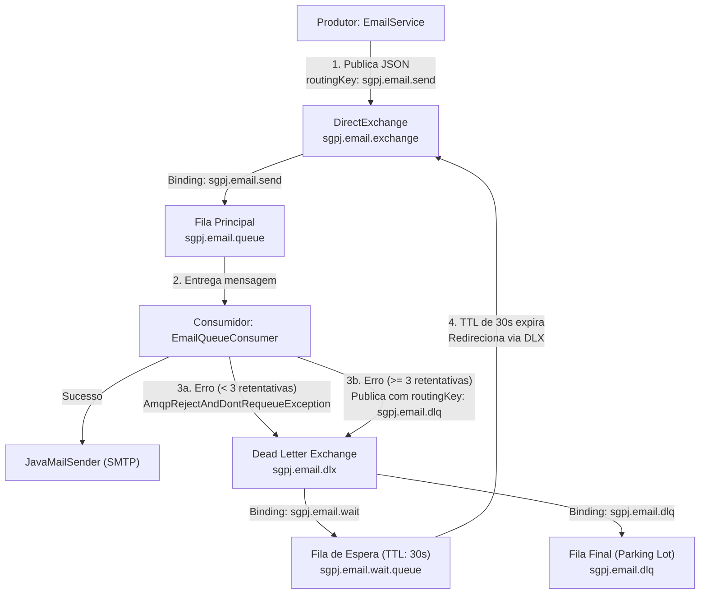
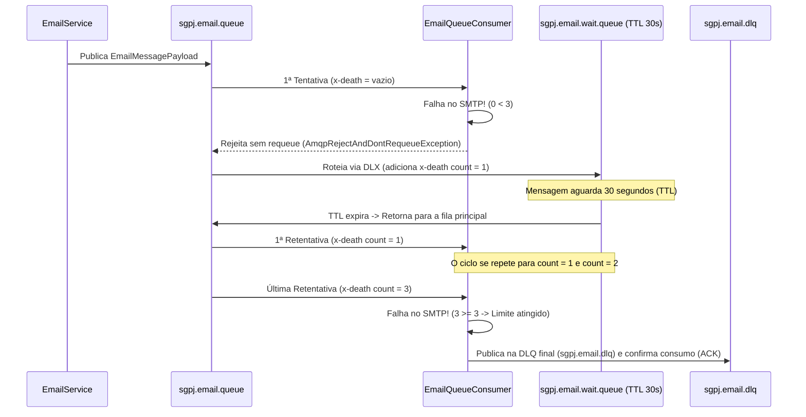

# Documentação Técnica: Arquitetura de Filas de E-mail (RabbitMQ DLX + TTL) e ShedLock

Este documento explica detalhadamente o funcionamento da arquitetura de envio assíncrono de e-mails com retentativas automáticas (**RabbitMQ com Dead Letter Exchange e Time-To-Live**) e controle de concorrência entre múltiplas instâncias (**ShedLock**) no backend do **SGPJ**.

---

## 1. Motivação e Problemas Resolvidos

Antes desta implementação, o envio de e-mails ocorria diretamente em memória (ou na própria thread do agendador). Isso trazia três riscos operacionais em produção:
1. **Perda de e-mails em oscilações do servidor SMTP**: Se o servidor SMTP (ex.: Gmail) sofresse *timeout*, queda momentânea de rede ou *rate limit*, o e-mail falhava imediatamente e era perdido.
2. **Loops de retentativa sem pausa (*busy-waiting*)**: Em mensageria tradicional, devolver uma mensagem com erro diretamente para a mesma fila (`requeue = true`) faz com que o consumidor tente reprocessá-la milhares de vezes por segundo, sobrecarregando a aplicação e o servidor SMTP.
3. **E-mails duplicados em ambiente com múltiplas instâncias ( Escalabilidade Horizontal )**: Caso 2 ou mais réplicas do backend estivessem rodando simultaneamente às `00h00`, todas disparariam o `@Scheduled` ao mesmo tempo, enviando e-mails duplicados para cada usuário.

A arquitetura implementada resolve os três problemas combinando **RabbitMQ (DLX + TTL + DLQ)** e **ShedLock (JDBC)**.

---

## 2. Topologia do RabbitMQ (Estratégia DLX + TTL + DLQ)

A configuração da topologia está centralizada na classe [`RabbitMQEmailConfig.java`](file:///C:/Users/leona/OneDrive/%C3%81rea%20de%20Trabalho/Backend/src/main/java/br/com/sgpj/config/RabbitMQEmailConfig.java).

### Visão Geral do Fluxo



### Componentes da Topologia

| Tipo | Nome | Papel na Arquitetura |
| :--- | :--- | :--- |
| **DirectExchange** | `sgpj.email.exchange` | Exchange principal que recebe solicitações de envio de e-mail (novas ou vindas de retentativa após o TTL). |
| **DirectExchange** | `sgpj.email.dlx` | *Dead Letter Exchange* para onde mensagens rejeitadas ou definitivamente falhas são roteadas. |
| **Queue (Durável)** | `sgpj.email.queue` | Fila principal consumida pelo [`EmailQueueConsumer`](file:///C:/Users/leona/OneDrive/%C3%81rea%20de%20Trabalho/Backend/src/main/java/br/com/sgpj/service/useCases/email/EmailQueueConsumer.java). Configurada com `x-dead-letter-exchange = sgpj.email.dlx` e `x-dead-letter-routing-key = sgpj.email.wait`. |
| **Queue (Durável)** | `sgpj.email.wait.queue` | Fila de espera (**sem consumidor**). Possui `x-message-ttl = 30000` (30s), `x-dead-letter-exchange = sgpj.email.exchange` e `x-dead-letter-routing-key = sgpj.email.send`. |
| **Queue (Durável)** | `sgpj.email.dlq` | Fila final (*Parking Lot*) onde ficam armazenadas as mensagens que falharam mesmo após todas as retentativas, permitindo auditoria ou reprocessamento manual. |

### Como funciona o Ciclo de Espera (DLX + TTL)



1. **Sem bloqueio de threads**: Enquanto a mensagem aguarda os 30 segundos na `sgpj.email.wait.queue`, nenhuma thread do Java fica bloqueada com `Thread.sleep()`. O próprio broker RabbitMQ controla o temporizador (`x-message-ttl`).
2. **Retorno automático**: Assim que os 30 segundos terminam, a mensagem na `sgpj.email.wait.queue` "morre" por expiração de TTL e o RabbitMQ aplica a regra de *dead-letter* configurada nessa fila de espera: enviá-la de volta para o `sgpj.email.exchange` com a chave `sgpj.email.send`, caindo novamente na `sgpj.email.queue` para ser consumida.

---

## 3. Detalhamento das Classes do Serviço de E-mail

### 3.1. Contrato da Mensagem: [`EmailMessagePayload.java`](file:///C:/Users/leona/OneDrive/%C3%81rea%20de%20Trabalho/Backend/src/main/java/br/com/sgpj/dto/EmailMessagePayload.java)
É um `record` Java imutável serializado e desserializado em JSON pelo `Jackson2JsonMessageConverter`:
```java
public record EmailMessagePayload(
        String to,
        String subject,
        String body
) {}
```
Como o template HTML já é renderizado antes do envio para a fila, a mensagem na fila é autocontida (não depende de sessão JPA ou consultas ao banco no momento do consumo).

### 3.2. Produtor e Transporte SMTP: [`EmailService.java`](file:///C:/Users/leona/OneDrive/%C3%81rea%20de%20Trabalho/Backend/src/main/java/br/com/sgpj/service/EmailService.java)
O [`EmailService`](file:///C:/Users/leona/OneDrive/%C3%81rea%20de%20Trabalho/Backend/src/main/java/br/com/sgpj/service/EmailService.java) possui duas responsabilidades bem divididas:

1. **Enfileiramento Rápido (`enqueueEmail`)**:
   Todos os métodos de negócio chamados pelos casos de uso ou agendadores apenas renderizam o HTML via [`RenderEmailBody`](file:///C:/Users/leona/OneDrive/%C3%81rea%20de%20Trabalho/Backend/src/main/java/br/com/sgpj/service/useCases/email/RenderEmailBody.java) e publicam o payload no RabbitMQ:
   - [`sendForgotPasswordOtp`](file:///C:/Users/leona/OneDrive/%C3%81rea%20de%20Trabalho/Backend/src/main/java/br/com/sgpj/service/EmailService.java#L38-L41): E-mail de recuperação de senha com OTP.
   - [`sendSetPasswordOtp`](file:///C:/Users/leona/OneDrive/%C3%81rea%20de%20Trabalho/Backend/src/main/java/br/com/sgpj/service/EmailService.java#L43-L46): E-mail de boas-vindas/primeiro acesso com OTP.
   - [`sendWeeklyHearings`](file:///C:/Users/leona/OneDrive/%C3%81rea%20de%20Trabalho/Backend/src/main/java/br/com/sgpj/service/EmailService.java#L48-L51): Resumo semanal de audiências.
   - [`sendDailyHearings`](file:///C:/Users/leona/OneDrive/%C3%81rea%20de%20Trabalho/Backend/src/main/java/br/com/sgpj/service/EmailService.java#L53-L56): Lembrete diário de audiências.

2. **Disparo SMTP Efetivo (`buildEmail`)**:
   O método [`buildEmail(String to, String subject, String body)`](file:///C:/Users/leona/OneDrive/%C3%81rea%20de%20Trabalho/Backend/src/main/java/br/com/sgpj/service/EmailService.java#L67-L81) monta o `MimeMessage` em UTF-8 e invoca `mailSender.send(message)`. Ele é chamado pelo consumidor da fila.

### 3.3. Consumidor e Controle de `x-death`: [`EmailQueueConsumer.java`](file:///C:/Users/leona/OneDrive/%C3%81rea%20de%20Trabalho/Backend/src/main/java/br/com/sgpj/service/useCases/email/EmailQueueConsumer.java)
A classe [`EmailQueueConsumer`](file:///C:/Users/leona/OneDrive/%C3%81rea%20de%20Trabalho/Backend/src/main/java/br/com/sgpj/service/useCases/email/EmailQueueConsumer.java) escuta a fila `sgpj.email.queue` por meio da anotação `@RabbitListener(queues = RabbitMQEmailConfig.EMAIL_QUEUE)`.

#### Como o cabeçalho `x-death` é lido
Toda vez que uma mensagem é rejeitada na `sgpj.email.queue` e passa por uma *Dead Letter Exchange*, o RabbitMQ insere/atualiza automaticamente nos headers da mensagem uma lista chamada `x-death`. Cada item dessa lista é um mapa contendo o nome da fila de origem (`queue`) e a quantidade de vezes (`count`) que a mensagem morreu naquela fila:

```java
private long extrairTentativasXDeath(Message amqpMessage) {
    if (amqpMessage == null || amqpMessage.getMessageProperties() == null) {
        return 0L;
    }

    List<Map<String, ?>> xDeathHeader = amqpMessage.getMessageProperties().getXDeathHeader();
    if (xDeathHeader == null || xDeathHeader.isEmpty()) {
        return 0L;
    }

    for (Map<String, ?> deathEntry : xDeathHeader) {
        Object queue = deathEntry.get("queue");
        Object count = deathEntry.get("count");
        if ((queue == null || RabbitMQEmailConfig.EMAIL_QUEUE.equals(queue)) && count instanceof Number number) {
            return number.longValue();
        }
    }

    return 0L;
}
```

#### Decisão entre Retentar (DLX/TTL) ou Enviar para a DLQ Final
- **Se `tentativasRealizadas < maxRetries` (padrão `3`)**:
  O consumidor lança `AmqpRejectAndDontRequeueException`. Essa exceção instrui o Spring AMQP a enviar um `basic.nack` / `basic.reject` com `requeue = false` ao RabbitMQ, acionando o envio imediato para a `sgpj.email.wait.queue`.
- **Se `tentativasRealizadas >= maxRetries`**:
  Significa que o envio original falhou e todas as 3 retentativas posteriores (após esperas de 30s cada) também falharam. Para evitar um loop infinito, o consumidor **não** relança a exceção: ele registra um `log.error` detalhado e publica o payload diretamente na fila `sgpj.email.dlq` (`rabbitTemplate.convertAndSend(EMAIL_DLX, ROUTING_KEY_DLQ, payload)`).

---

## 4. Coordenação de Instâncias com ShedLock

Para evitar que múltiplas instâncias da aplicação em produção executem o mesmo job agendado (`@Scheduled`) simultaneamente, foi configurado o **ShedLock** com persistência via JDBC no banco MySQL.

### 4.1. Configuração e Tabela de Lock
- **[`SchedulerLockConfig.java`](file:///C:/Users/leona/OneDrive/%C3%81rea%20de%20Trabalho/Backend/src/main/java/br/com/sgpj/config/SchedulerLockConfig.java)**:
  Configura o bean `LockProvider` com `.usingDbTime()`, fazendo com que o controle de tempo use o relógio centralizado do servidor MySQL (evitando problemas caso os relógios dos containers de aplicação tenham pequenas diferenças de segundos).
- **Tabela `shedlock` em [`schema.sql`](file:///C:/Users/leona/OneDrive/%C3%81rea%20de%20Trabalho/Backend/src/main/resources/schema.sql#L1175-L1185)**:
  ```sql
  CREATE TABLE shedlock (
      name VARCHAR(64) NOT NULL,
      lock_until TIMESTAMP(3) NOT NULL,
      locked_at TIMESTAMP(3) NOT NULL DEFAULT CURRENT_TIMESTAMP(3),
      locked_by VARCHAR(255) NOT NULL,
      PRIMARY KEY (name)
  );
  ```

### 4.2. Agendadores Protegidos
1. **[`HearingNotificationScheduler.java`](file:///C:/Users/leona/OneDrive/%C3%81rea%20de%20Trabalho/Backend/src/main/java/br/com/sgpj/service/useCases/email/HearingNotificationScheduler.java)**:
   - `enviarNotificacoesSemanais()` (`0 0 0 * * SUN`): protegido com `@SchedulerLock(name = "HearingNotificationScheduler_enviarNotificacoesSemanais", lockAtLeastFor = "PT1M", lockAtMostFor = "PT15M")`.
   - `enviarNotificacoesDiarias()` (`0 0 0 * * *`): protegido com `@SchedulerLock(name = "HearingNotificationScheduler_enviarNotificacoesDiarias", lockAtLeastFor = "PT1M", lockAtMostFor = "PT15M")`.
2. **[`OtpCleanupScheduler.java`](file:///C:/Users/leona/OneDrive/%C3%81rea%20de%20Trabalho/Backend/src/main/java/br/com/sgpj/service/otp/OtpCleanupScheduler.java)**:
   - `cleanup()` (`0 */10 * * * *`): protegido com `@SchedulerLock(name = "OtpCleanupScheduler_cleanup", lockAtLeastFor = "PT30S", lockAtMostFor = "PT5M")`.

- **`lockAtLeastFor`**: Garante que o lock permaneça retido por pelo menos 1 minuto (ou 30s no OTP), impedindo que uma segunda instância execute a mesma tarefa mesmo se a primeira terminar em poucos milissegundos.
- **`lockAtMostFor`**: Tempo máximo de segurança (ex.: 15 minutos) para liberar o lock automaticamente caso a instância que o adquiriu sofra uma queda abrupta (*crash*) no meio da execução.

---

## 5. Propriedades de Configuração

As configurações no [`application.properties`](file:///C:/Users/leona/OneDrive/%C3%81rea%20de%20Trabalho/Backend/src/main/resources/application.properties#L58-L65) podem ser customizadas via variáveis de ambiente:

| Propriedade | Variável de Ambiente | Valor Padrão | Descrição |
| :--- | :--- | :--- | :--- |
| `spring.rabbitmq.host` | `RABBITMQ_HOST` | `localhost` | Host do servidor RabbitMQ |
| `spring.rabbitmq.port` | `RABBITMQ_PORT` | `5672` | Porta AMQP do RabbitMQ |
| `spring.rabbitmq.username` | `RABBITMQ_USERNAME` | `guest` | Usuário de conexão |
| `spring.rabbitmq.password` | `RABBITMQ_PASSWORD` | `guest` | Senha de conexão |
| `sgpj.email.queue.retry-ttl-ms` | `EMAIL_RETRY_TTL_MS` | `30000` (30s) | Tempo de espera (TTL) na `sgpj.email.wait.queue` antes de cada nova tentativa |
| `sgpj.email.queue.max-retries` | `EMAIL_MAX_RETRIES` | `3` | Quantidade máxima de retentativas antes de enviar a mensagem para a `sgpj.email.dlq` |
