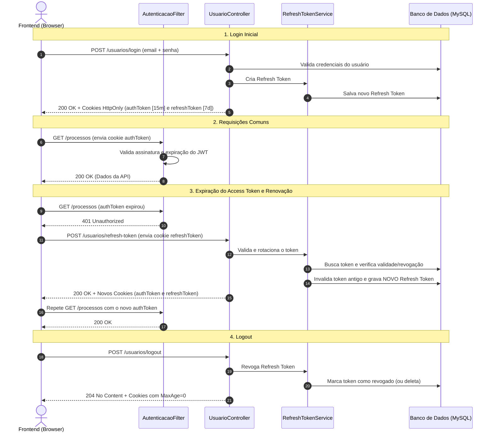

# Guia de Implementação: Refresh Token para Autenticação (SGPJ)

Este documento descreve a arquitetura, o fluxo de funcionamento e o passo a passo detalhado para implementar a autenticação com **Access Token (JWT)** e **Refresh Token com Rotação (Refresh Token Rotation)** no ecossistema do backend SGPJ.

---

## 1. Conceito e Motivação

### O Problema do Token Único
Atualmente, o sistema gera apenas um `authToken` (JWT) com validade fixa (ex: 1 hora ou mais). 
- Se a validade for **curta**, o usuário é deslogado frequentemente.
- Se a validade for **longa**, caso o token seja interceptado, o invasor terá acesso por um período prolongado sem possibilidade de revogação imediata (pois JWTs são *stateless*).

### A Solução: Access Token + Refresh Token
| Token | Tipo | Tempo de Vida | Armazenamento | Propósito |
| :--- | :--- | :--- | :--- | :--- |
| **Access Token** | JWT assinado | Curto (ex: 15 min) | Cookie `HttpOnly` (`authToken`) | Autorizar requisições aos endpoints da API. |
| **Refresh Token** | Token opaco/UUID (persistido) | Longo (ex: 7 dias) | Cookie `HttpOnly` (`refreshToken`) + Banco de Dados | Renovar o Access Token sem exigir novo login do usuário. |

### Rotação de Refresh Token (*Refresh Token Rotation*)
A cada vez que o cliente solicita um novo *Access Token* utilizando o *Refresh Token*, um **novo** *Refresh Token* é emitido e o anterior é invalidado no banco de dados.
- **Detecção de Reuso:** Se um *Refresh Token* antigo já utilizado for apresentado novamente, o sistema detecta uma possível tentativa de ataque e revoga todas as sessões ativas do usuário.

---

## 2. Fluxo da Arquitetura



---

## 3. Passo a Passo de Implementação

Abaixo estão as etapas organizadas de acordo com o padrão do projeto SGPJ.

---

### Passo 1: Modelagem no Banco de Dados (`schema.sql`)

Crie uma tabela para armazenar os *Refresh Tokens* emitidos para cada usuário:

```sql
CREATE TABLE usuario_refresh_token (
    id BIGINT AUTO_INCREMENT PRIMARY KEY,
    token VARCHAR(255) NOT NULL UNIQUE,
    usuario_id BIGINT NOT NULL,
    expira_em DATETIME NOT NULL,
    revogado TINYINT NOT NULL DEFAULT 0,
    criado_em DATETIME NOT NULL DEFAULT CURRENT_TIMESTAMP,

    FOREIGN KEY (usuario_id) REFERENCES usuario(id) ON DELETE CASCADE
);

CREATE INDEX idx_refresh_token_usuario ON usuario_refresh_token(usuario_id);
CREATE INDEX idx_refresh_token_valor ON usuario_refresh_token(token);
```

---

### Passo 2: Entidade JPA e Repositório

#### Entidade `UsuarioRefreshToken.java`
Local: `src/main/java/br/com/sgpj/entity/UsuarioRefreshToken.java`

Campos sugeridos:
* `Long id`
* `String token` (UUID aleatório gerado com `UUID.randomUUID().toString()`)
* `Usuario usuario` (relacionamento `@ManyToOne(fetch = FetchType.LAZY)`)
* `LocalDateTime expiraEm`
* `boolean revogado`
* `LocalDateTime criadoEm`

#### Repositório `UsuarioRefreshTokenRepository.java`
Local: `src/main/java/br/com/sgpj/repository/UsuarioRefreshTokenRepository.java`

Métodos necessários:
* `Optional<UsuarioRefreshToken> findByToken(String token);`
* `void deleteByUsuario(Usuario usuario);` (ou exclusão por ID)
* `Optional<UsuarioRefreshToken> findByTokenAndRevogadoFalse(String token);`

---

### Passo 3: Configurações de Propriedades (`application.properties`)

Defina os tempos de expiração explícitos:

```properties
# Access Token: 15 minutos (900 segundos)
jwt.validity=900

# Refresh Token: 7 dias (604800 segundos)
jwt.refresh.validity=604800
```

---

### Passo 4: Serviço de Gerenciamento do Refresh Token (`RefreshTokenService.java`)

Local sugerido: `src/main/java/br/com/sgpj/service/RefreshTokenService.java`

Responsabilidades:
1. **`criarRefreshToken(Usuario usuario)`**:
   - Gera um token UUID único (`UUID.randomUUID().toString()`).
   - Define a data de expiração (`LocalDateTime.now().plusSeconds(refreshValidity)`).
   - Salva na tabela `usuario_refresh_token`.
   - Retorna o objeto/token gerado.

2. **`validarERotacionar(String tokenString)`**:
   - Busca o registro pelo token no repositório.
   - **Caso 1 (Não encontrado ou Revogado):** Se o token foi revogado previamente, pode indicar reuso indevido. Lança exceção de segurança (`TokenInvalidoException` / `SecurityException`).
   - **Caso 2 (Expirado):** Verifica se `expiraEm.isBefore(LocalDateTime.now())`. Se sim, marca como revogado/deleta e lança exceção.
   - **Caso 3 (Válido):** 
     - Invalida (ou remove) o token atual.
     - Cria um **novo** `UsuarioRefreshToken` para o mesmo usuário.
     - Gera um novo *Access Token* JWT via `GerenciadorTokenJwt`.
     - Retorna o par: novo *Access Token* + novo *Refresh Token*.

3. **`revogarToken(String tokenString)`**:
   - Marca o registro como revogado ou remove-o do banco durante o logout.

---

### Passo 5: Gerenciamento dos Cookies HTTP

No `UsuarioController.java` (ou numa classe auxiliar `CookieUtil`):

Crie constantes e métodos utilitários para configurar os dois cookies:

```java
public static final String ACCESS_TOKEN_COOKIE = "authToken";
public static final String REFRESH_TOKEN_COOKIE = "refreshToken";

private void adicionarCookie(HttpServletResponse response, String nome, String valor, Duration duracao, String path) {
    ResponseCookie cookie = ResponseCookie.from(nome, valor)
            .httpOnly(true)
            .secure(false) // true em produção (HTTPS)
            .sameSite("Strict")
            .path(path)
            .maxAge(duracao)
            .build();
    response.addHeader(HttpHeaders.SET_COOKIE, cookie.toString());
}
```

> **Dica de Segurança para o Path do Refresh Token:**
> O cookie do `refreshToken` pode ser configurado com `path("/usuarios/refresh-token")` (ou `path("/usuarios")`). Dessa forma, o browser só envia o Refresh Token para a rota de renovação, não poluindo as demais requisições da API.

---

### Passo 6: Atualização dos Endpoints em `UsuarioController.java`

1. **`POST /usuarios/login`**:
   - Autentica credenciais.
   - Gera `authToken` (JWT de 15 min) e adiciona ao cookie `authToken`.
   - Gera `refreshToken` (UUID de 7 dias) e adiciona ao cookie `refreshToken`.
   - Retorna os dados da sessão do usuário no corpo.

2. **Novo Endpoint: `POST /usuarios/refresh-token`**:
   - Extrai o cookie `refreshToken` do `HttpServletRequest`.
   - Caso não exista: retorna `401 Unauthorized`.
   - Chama `refreshTokenService.validarERotacionar(token)`.
   - Atualiza ambos os cookies na resposta (`authToken` e `refreshToken`).
   - Retorna `200 OK` (ou dados de sessão atualizados).

3. **`POST /usuarios/logout`**:
   - Extrai o `refreshToken` e chama `refreshTokenService.revogarToken(token)`.
   - Limpa ambos os cookies (`maxAge(Duration.ZERO)`).
   - Retorna `204 No Content`.

---

### Passo 7: Liberação no Spring Security (`SecurityConfiguracao.java`)

Adicione o novo endpoint de refresh à lista `URLS_PERMITIDAS`:

```java
private static final String[] URLS_PERMITIDAS = {
    // ...
    "/usuarios/login/**",
    "/usuarios/logout/**",
    "/usuarios/refresh-token/**", // <-- Adicionar aqui
    // ...
};
```

---

## 4. Integração com o Frontend (Axios Interceptor)

Para que a renovação ocorra de forma transparente ao usuário, o frontend geralmente utiliza um **Response Interceptor** do Axios:

```javascript
import axios from 'axios';

const api = axios.create({
  baseURL: 'http://localhost:8080',
  withCredentials: true // Envia os cookies HttpOnly
});

let isRefreshing = false;
let failedQueue = [];

const processQueue = (error) => {
  failedQueue.forEach(prom => {
    if (error) {
      prom.reject(error);
    } else {
      prom.resolve();
    }
  });
  failedQueue = [];
};

api.interceptors.response.use(
  (response) => response,
  async (error) => {
    const originalRequest = error.config;

    // Se receber 401 e não for a própria requisição de login/refresh
    if (error.response?.status === 401 && !originalRequest._retry && !originalRequest.url.includes('/usuarios/refresh-token')) {
      if (isRefreshing) {
        return new Promise((resolve, reject) => {
          failedQueue.push({ resolve, reject });
        }).then(() => api(originalRequest)).catch(err => Promise.reject(err));
      }

      originalRequest._retry = true;
      isRefreshing = true;

      try {
        await api.post('/usuarios/refresh-token');
        processQueue(null);
        return api(originalRequest); // Reexecuta a requisição original com o novo cookie
      } catch (refreshError) {
        processQueue(refreshError);
        // Redireciona para o login caso o refresh token também tenha expirado
        window.location.href = '/login';
        return Promise.reject(refreshError);
      } finally {
        isRefreshing = false;
      }
    }

    return Promise.reject(error);
  }
);
```

---

## 5. Checklist de Verificação e Testes

- [ ] A tabela `usuario_refresh_token` foi adicionada ao `schema.sql`.
- [ ] No login (`/usuarios/login`), ambos os cookies (`authToken` e `refreshToken`) são enviados com `HttpOnly`.
- [ ] Quando o `authToken` expira, a API retorna `401 Unauthorized`.
- [ ] A chamada para `/usuarios/refresh-token` invalida o token anterior, cria um novo no banco e devolve novos cookies.
- [ ] Tentativas de reuso de token antigo retornam erro e revogam a sessão.
- [ ] No `/usuarios/logout`, o token é removido/revogado do banco e os cookies são zerados.
- [ ] Testes unitários com JUnit/Mockito cobrindo cenários de sucesso, token expirado e token inválido.
